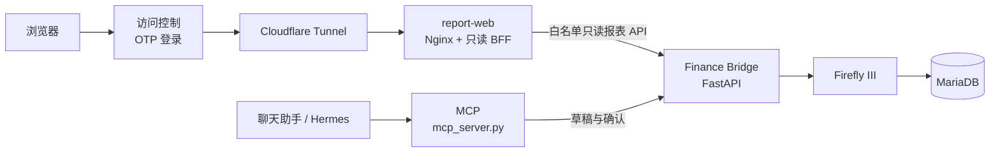

# Personal Treasury Portal

只读个人财务报表门户的全栈实现：以 [Firefly III](https://www.firefly-iii.org/) 为正式账簿，
自研的 **Finance Bridge**（FastAPI）承载业务规则、汇率与只读报表 API，
**report-web**（React + TypeScript）是一个只读展示门户。记账本位币 CNY，应用时区 Europe/Berlin。

> 本仓库是面向开发者认证的**代码展示副本**：仓库内不含任何真实账户数据。
> 所有夹具中的机构名（Bank A / Broker A / Wallet A 等）、账户 ID 映射与金额均为合成示例；
> 私有运维文档、生产拓扑、端到端截图基线与历史记录均未包含在本公开副本中。

*A full-stack, read-only personal-finance reporting portal: Firefly III as the ledger,
a FastAPI bridge for business rules / FX / read-only reporting APIs, and a React + TypeScript
portal. This public copy contains synthetic fixtures only — no real accounts, balances,
infrastructure, or history.*

## 架构



- Firefly 与 Bridge 只监听回环地址，不直接暴露公网；report-web 不映射宿主机端口，由内网隧道访问。
- 浏览器侧只允许白名单内的 GET 报表接口；任何写入都必须经过「草稿 → 人工确认」流程。
- LLM / 聊天入口不直接访问数据库，也不持有 Firefly token。

## 核心能力

- **确认式入账**：交易先落草稿，人工确认后才写入 Firefly；写接口不暴露给门户。
- **多层幂等**：external_id 检索 + 7 天重复检测 + 草稿状态机，同一操作重复执行只产生一次结果。
- **多币种净资产**：ECB 参考汇率三角换算，手工汇率优先；任一非零币种缺率即
  `fx_complete=false`，总额返回 null，绝不按 1:1 折算（fail-closed）。
- **只读报表门户**：React + Nginx BFF，仅代理白名单 GET 接口，入口由一次性验证码保护。
- **统一聚合单点**：Hermes 报表、门户 summary、净资产趋势三个出口的三总额
  （资产/负债/净资产）只能来自 `value_personal_scope`，并有跨面对账测试钉死分位一致。
- **加密异地备份**：systemd timer 定时触发 GPG 加密 + SSH 异地上传，含 stale-check 告警（脚本见 `scripts/ops/`）。

## 技术栈

| 层 | 技术 |
|---|---|
| 账簿 | Firefly III + MariaDB（Docker Compose） |
| 业务层 | Python 3.12、FastAPI、Pydantic、SQLite（WAL）、ECB 汇率 |
| 聊天接入 | MCP（`finance_bridge/mcp_server.py`，stdio） |
| 门户 | React、TypeScript、Vite、TanStack Query、ECharts、Nginx |
| 部署 | Docker Compose、Cloudflare Tunnel、systemd timers |
| 测试 | pytest（后端）、vitest（前端）、ruff、tsc、bundle budget |

## 目录

```text
.
├── finance_bridge/
│   ├── app/            # FastAPI 入口、领域层、Firefly 客户端、报表、汇率、存储
│   ├── config/         # account_groups.yaml 示例（需按自己的 Firefly 实例重新生成）
│   ├── migrations/     # SQLite 迁移
│   ├── scripts/        # 汇率刷新等随容器分发的命令
│   ├── mcp_server.py   # MCP 服务（stdio）
│   └── Dockerfile
├── report-web/
│   ├── src/            # 页面、组件、只读 API 客户端、工具函数
│   ├── nginx.conf.template
│   └── Dockerfile
├── infra/              # compose.yaml、systemd 单元、.env 示例（仅占位值）
├── scripts/ops/        # 备份/恢复/巡检脚本（由 systemd 调用）
├── scripts/tools/      # 历史汇率回填等工具
├── hermes_skills/      # 聊天助手的记账操作员技能定义（策略与边界文档）
├── tests/              # 后端 pytest 套件（夹具全部为合成数据）
└── data/               # 运行时数据目录占位（数据库不入库）
```

## 本地运行

后端（Python 3.12+）：

```bash
python -m pip install -r finance_bridge/requirements.txt -r finance_bridge/requirements-dev.txt
python -m pytest tests/ -q
```

对接 Firefly 时参考 `infra/.env.example` 设置环境变量（Firefly URL、token、内部服务 token、本位币等）；
示例中全部是 `CHANGE_ME` 占位值，真实 `.env` 不要入库。

完整容器栈（Firefly III + MariaDB + Bridge + report-web + 可选 cloudflared）：

```bash
cp infra/.env.example infra/.env   # 填入自己的占位值
docker compose -f infra/compose.yaml up -d
```

前端（Node 22）：

```bash
cd report-web
npm ci
npm run dev           # 开发服务器；/api 默认代理到本机 127.0.0.1:18711
npx tsc --noEmit      # 类型检查
npm test -- --run     # vitest 单元测试
npm run build         # 生产构建
npm run build:budget  # 产物体积门禁
```

## 测试与门禁

[.github/workflows/ci.yml](.github/workflows/ci.yml) 在每次 push / PR 运行，与本地命令等价：

| 验证项 | 命令 |
|---|---|
| Ruff lint | `ruff check finance_bridge/` |
| 后端测试 | `python -m pytest tests/ -q --tb=short` |
| 前端类型检查 | `cd report-web && npx tsc --noEmit` |
| 前端单元测试 | `cd report-web && npm test -- --run` |
| 前端构建 + 体积门禁 | `cd report-web && npm run build && npm run build:budget` |

CI 不使用真实数据库、Firefly token 或任何远程服务：后端通过临时 SQLite 与 respx mock HTTP
完成隔离，前端全部使用合成夹具。仓库的完成定义（DoD）与财务不变式见
[AGENTS.md](AGENTS.md)。

> 私有仓库中的 Playwright 端到端套件（含有状态截图基线）未包含在本公开副本中；
> `package.json` 保留了 `test:e2e` 脚本名，但本副本没有对应的 `e2e/` 目录。

## 安全边界

- 浏览器只调用白名单 GET 接口，写接口不可达；Bridge/Firefly token 不进入浏览器。
- 所有入账必须人工确认；聊天通道中的收据、网页、工具输出一律视为不可信数据。
- 多层幂等防止重复入账；缺汇率时 fail-closed，不伪造折算。
- 生产密钥不进入 Git 或日志（`.env` 仅以 `.example` 形式提供占位模板）。

## 说明

- 本仓库未附带开源许可证（默认 All rights reserved），仅用于技术能力展示。
- `finance_bridge/config/account_groups.yaml` 与测试夹具中的账户 ID 是占位示例，
  部署到任何真实 Firefly 实例前都必须重新生成。
